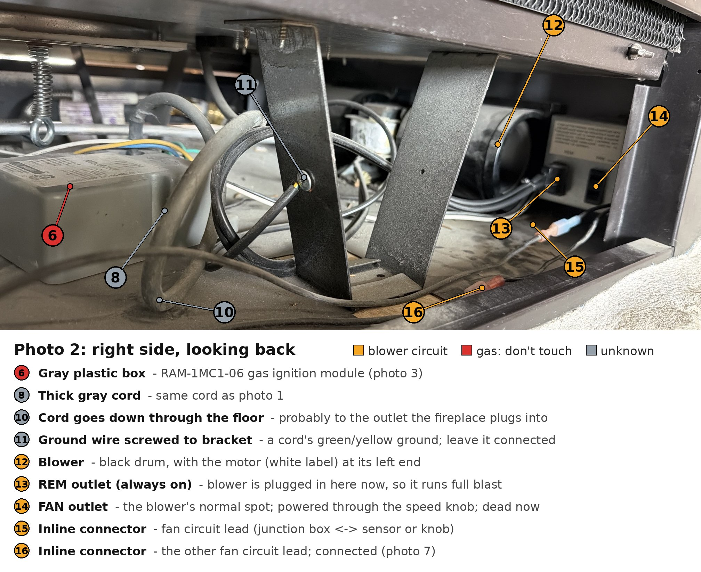
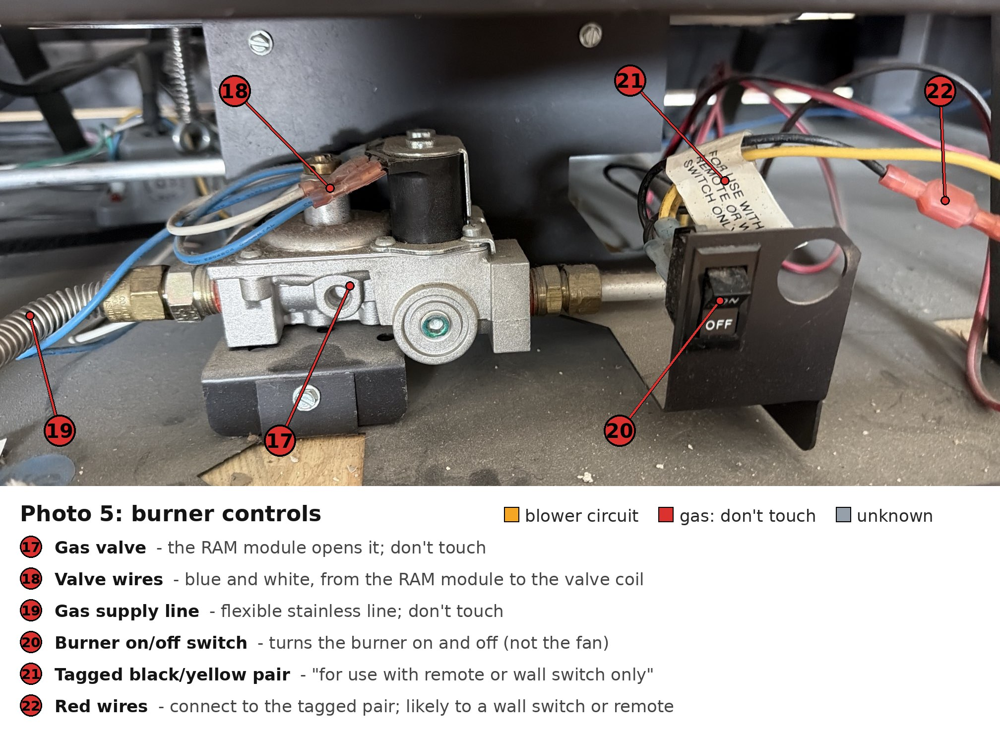
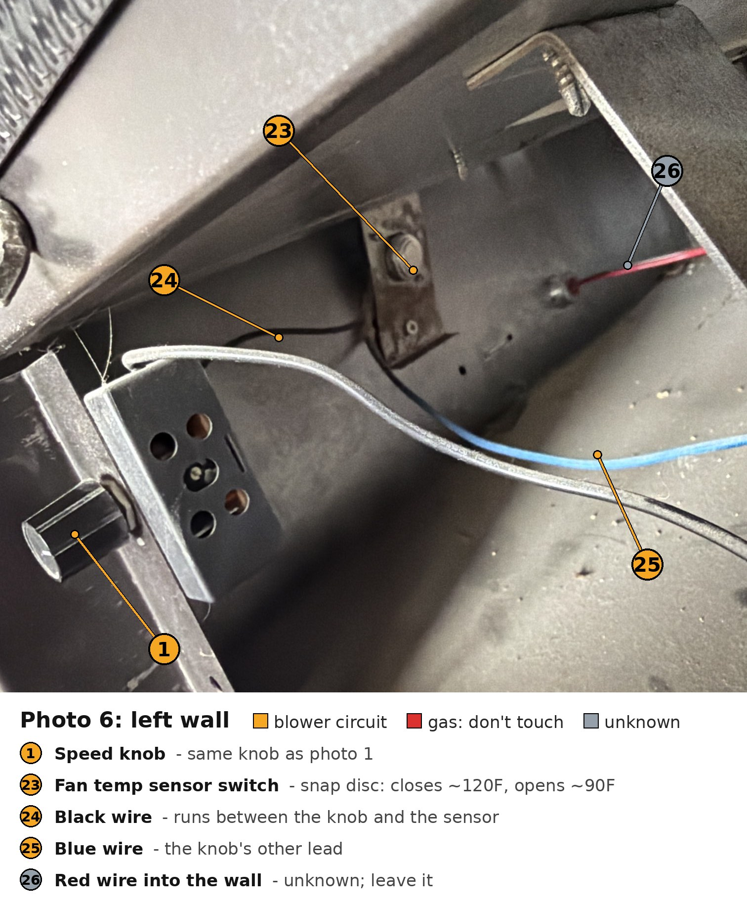
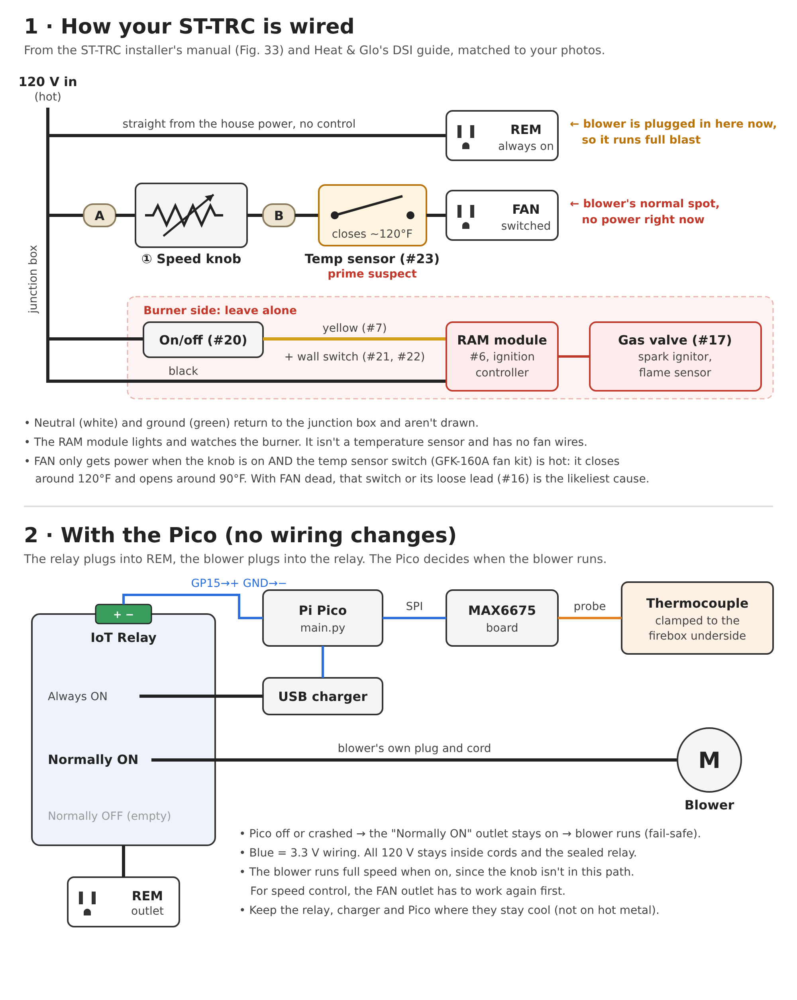

# Fireplace Blower Controller (Raspberry Pi Pico)

Replaces a fireplace's dead fan-temperature switch with a Raspberry Pi Pico.
A heat-proof thermocouple probe watches the firebox. The Pico turns the blower
on when it gets hot and off once it cools down. It also does a few things the
stock switch can't:

- **Adjustable on/off temperatures.** The stock switch is fixed at about 120°F on and 90°F off.
- **Minimum run time**, so the blower doesn't click on and off.
- **Fail-safe.** If the probe breaks or comes unplugged, or the Pico itself dies, the blower **runs** instead of staying off.
- **Optional button** to force the blower on.
- **Status LED**, plus a live temperature log over USB.

> **Cheaper fix first?** If the "temp sensor" that died is the little round
> snap-disc switch near the blower, a replacement (120°F on / 90°F off, about
> $15–25) is a 10-minute swap. This project is for when you want more control
> than that, or just want to build it.

---

## Safety: read this first

- **This only switches the blower.** Don't touch the gas valve, pilot, thermopile, or any of the fireplace's own controls.
- **No mains wiring.** The IoT Relay below is a sealed power strip with a low-voltage control input. You plug things into it like a power strip, and the Pico only ever touches 3.3 volts.
- **Only the probe goes near the heat.** Keep the Pico, the thermocouple board, the relay, and the USB charger somewhere that stays cool enough to touch comfortably. The Pico is rated to 85°C (185°F), and the USB charger less.
- **If your blower is hard-wired (no plug)**, don't splice into 120 V house wiring unless you know how. Have an electrician add an outlet for the blower, then use this setup as-is.
- Fireplaces are designed to run safely without the blower (during power outages, for example). Even so, this design defaults to "blower on" whenever anything goes wrong.

---

## Parts (about $60–80)

| Part | Notes |
|---|---|
| Raspberry Pi Pico (or Pico W / Pico 2) **with headers** | about $5–8 |
| **MAX6675 board + K-type thermocouple** | about $6–10 kit. Get a probe with a **fiberglass or stainless-braided lead** long enough to reach a cool spot (1–2 m). A ring/washer-style or screw-in probe is easiest to mount. A MAX31855 board also works (set `SENSOR = "MAX31855"`). |
| **Digital Loggers "IoT Relay"** (IoT Power Relay II) | about $30–35. Sealed outlet box, switched by a 3.3 V signal. |
| USB phone charger + micro-USB cable | Powers the Pico (USB-C if you have a Pico 2 clone that uses it). |
| Female-to-female jumper wires | 5 for the sensor board, plus 2 longer wires for the relay input. |
| *Optional:* momentary push button | For the "always on" override. |
| *Optional:* small project box | Keeps it tidy. |

---

## How it hooks up

```
                          ┌──────────────── IoT Relay ─────────────────┐
  Wall outlet ───────────▶│  "Always ON"    ◀── USB charger ── Pico    │
                          │  "Normally ON"  ◀── fireplace blower plug  │
                          │  "Normally OFF" ×2  (leave empty)          │
                          │  control input + / −  ◀── Pico GP15 / GND  │
                          └────────────────────────────────────────────┘

  Thermocouple probe (in the heat) ── long lead ──▶ MAX6675 board ──▶ Pico (in the cool)
```

The blower plugs into the **"Normally ON"** outlet, so it runs unless the Pico
actively tells it to stop. That's the fail-safe: if the Pico crashes, loses
power, or a wire falls off, the blower runs. If you use a "Normally OFF" outlet
instead, set `FAN_ON_WHEN_PIN_HIGH = True` in `config.py`.

If your blower has a speed knob (rheostat), leave it in place. The Pico just
switches power to the blower, and the knob still sets the speed.

---

## Wiring

Pin numbers are the **physical pin numbers** printed on the Pico's pinout
(pin 1 is top-left with the USB port at the top).

**MAX6675 board → Pico**

| MAX6675 | Pico pin | Pico name |
|---|---|---|
| VCC | 36 | 3V3(OUT) |
| GND | 23 | GND |
| SCK | 24 | GP18 |
| CS  | 22 | GP17 |
| SO  | 21 | GP16 |

**IoT Relay control input → Pico** (the green screw terminal on the side)

| IoT Relay | Pico pin | Pico name |
|---|---|---|
| **+** | 20 | GP15 |
| **−** | 18 | GND |

**Push button (optional) → Pico**

| Button | Pico pin | Pico name |
|---|---|---|
| one leg | 19 | GP14 |
| other leg | 13 | GND |

**Thermocouple → MAX6675 screw terminals:** on US K-type wire the **red lead is
negative (−)** and the yellow lead is positive (+). If the reading goes *down*
when you heat the probe, swap them.

---

## Load the software

1. **Install MicroPython on the Pico.** Hold the **BOOTSEL** button while
   plugging the Pico into your computer. It shows up as a USB drive. Download
   the matching `.uf2` file from <https://micropython.org/download/> (search
   `RPI_PICO`, `RPI_PICO_W`, or `RPI_PICO2`) and drag it onto that drive. The
   Pico reboots on its own.
2. **Install Thonny** (<https://thonny.org>). In *Tools → Options → Interpreter*,
   pick **MicroPython (Raspberry Pi Pico)**.
3. **Copy the four files onto the Pico.** Open each of `config.py`,
   `fan_control.py`, `thermocouple.py`, and `main.py` in Thonny and use
   *File → Save as… → Raspberry Pi Pico*, keeping the same names. Copy
   `main.py` last.
4. Unplug and replug the Pico. `main.py` runs automatically every time it powers up.

---

## Bench test (before touching the fireplace)

Plug a **lamp** into the relay's "Normally ON" outlet in place of the blower,
and connect the Pico to your computer with Thonny open so you can watch the log:

```
[     10 s]  71.2 F  blower OFF (auto)
[    155 s] 120.2 F  blower ON  (auto)
```

1. **At power-up** the lamp comes on for about 5 seconds (self-test), then turns off because the probe is at room temperature.
2. **Heat the probe** (dip it in a mug of water from the kettle, or use a hair dryer). The lamp turns on once the reading passes 120°F.
3. **Let it cool.** The lamp stays on until the reading drops to 90°F, and always runs for at least 2 minutes once it comes on.
4. **Pull a thermocouple lead out of the screw terminal.** Within about 3 seconds the lamp comes on, the LED flickers fast, and the log says `SENSOR FAULT`.
5. **Press the button** (if wired). The LED blinks slowly and the lamp stays on. Press again to go back to auto.

---

## Map your fireplace's existing wiring










This fireplace is a **Heat & Glo ST-TRC** with direct spark ignition (a
**RAM-1MC1-06** module, #6) and the factory **GFK-160A fan kit**. The schematic
above follows the ST-TRC installer's manual (Figure 33, *Fan Wiring Diagram*,
page 35) and Heat & Glo's *DSI Troubleshooting Guide* (pages 4–7), matched to
the parts in the photos:

- **Junction box** (right side of the compartment) takes in 120 V and has two outlets:
  - **REM** (#13): always on. The blower is plugged in here right now, which is why it runs full blast with no control.
  - **FAN** (#14): where the blower is meant to plug in. Power reaches it through the **speed knob** (#1) **and** the fan kit's **temperature sensor switch**, one after the other. The sensor closes when the firebox warms up (about 120°F) and opens when it cools (about 90°F). FAN has no power right now.
- **Temperature sensor switch** (#23): a small disc on a bracket on the left wall. The fan circuit leaves and re-enters the junction box on two leads with woven high-temperature insulation, each joined by an inline spade connector (#15 and #16, both connected). One runs from the junction box to the sensor; the other runs from the knob back to the junction box.
- **RAM module** (#6): the gas *ignition* controller. It sparks the ignitor, opens the gas valve, and watches the flame. It is **not** a temperature sensor and has no fan wires. Leave it, the on/off switch and its wires (#7, #20–22), the gas valve and the gas line alone.

### Why the FAN outlet is dead: checks

As traced on this unit, the power runs **junction box → temp sensor (#23) →
speed knob → back to the junction box → FAN outlet**. The sensor comes first, so
when the fireplace is cold **none of the knob's wires are live**. That's normal.
The test points T1–T3 are marked on the schematic.

1. **End-to-end test (no tools):** plug a lamp into **FAN** and turn the knob all the way up. Warm the sensor's bracket with a hair dryer for 1–2 minutes; you may hear a faint click.
   - **Lamp comes on:** the sensor, knob and wiring all work. The real problem is that the sensor doesn't get to 120°F during a fire, which a very low flame would explain. Fix the flame, fit a lower-temperature disc, or let the Pico take over with a lower ON temperature.
   - **Lamp stays off:** go on to step 2.
2. **Non-contact voltage tester, fireplace plugged in, hair dryer still on the sensor:**
   - **T1** (wire from the junction box to the sensor) should beep. If it doesn't, power isn't leaving the junction box for the fan circuit.
   - **T2** (black wire from the sensor to the knob) should beep once the sensor is hot. If T1 beeps but T2 never does, **the sensor is dead**: replace it.
   - **T3** (wire from the knob back to the junction box) should beep with the knob turned up. If T2 beeps but T3 doesn't, **the knob is dead** (or one of its ceramic splices #2/#3 is loose): replace it.
3. **Replacing the sensor:** unplug the fireplace, remove the bracket's one screw, and read the code stamped on the back of the disc (for example `F120-20F`). Buy one with the same code and size, move the two wires across, and screw the bracket back.

If FAN works again with the sensor reconnected or replaced, the fireplace's own
automatic fan is back: the blower starts once the firebox warms up, and the knob
sets the speed. The Pico build below then becomes optional. What it adds is
adjustable on/off temperatures, a temperature log, and a fan that runs if
anything fails.

### Low flame (gas side: for a gas technician)

The ST-TRC's gas valve (#17) is an on/off valve with a **fixed** pressure
regulator. There's no high/low setting, so a full-size flame is the normal state
and a "super low" flame means something is off. This project doesn't touch the
gas side.

**Safe for a homeowner to check:**
- The **shut-off valve** on the gas line to the fireplace is fully open. On a quarter-turn valve, the handle lines up with the pipe.
- The **logs and ember material** aren't covering the burner ports. The manual says not to press embers into the ports or put them on the rear ports.
- On **propane**: the tank isn't low. Cold weather also drops tank pressure.
- Whether it's **weaker while other gas appliances run** (furnace, water heater), which points to an undersized supply line.

**For the technician**, from the ST-TRC installer's manual (Step 7, page 34, and the parts list):

| | Natural gas | Propane |
|---|---|---|
| Inlet pressure, minimum | 5.0" w.c. | 11.0" w.c. |
| Inlet pressure, maximum | 14.0" w.c. | 14.0" w.c. |
| Manifold pressure | 3.5" w.c. | 10.0" w.c. |
| Burner orifice | #32 DMS (573-800) | 1.8 mm (501-801) |

There are 1/8" NPT test ports on the inlet and outlet sides of the valve. Good
inlet pressure with low manifold pressure points at the valve's regulator; low
inlet pressure points at the supply. A dirty or blocked orifice, or dust and
spider webs in the burner's air intake, also cause a weak flame. In a compartment
this dusty, those are worth checking.

## Hook up the Pico (no wiring changes)

The Pico doesn't need the FAN outlet at all:

1. Plug the **IoT Relay** into the **REM** outlet (always on).
2. Plug the **blower** into the relay's **"Normally ON"** outlet.
3. Plug the **USB charger** for the Pico into the relay's **"Always ON"** outlet.
4. Clamp the **thermocouple** to bare metal on the **underside of the firebox**, where it gets hot within a few minutes of the burner lighting.

The blower then runs **full speed** whenever it's on, because the speed knob only
feeds the FAN outlet.

**Check the compartment temperature before leaving electronics in it.** The
junction box label says any replacement wire must be rated for 105°C, so parts of
this compartment get hot. The relay and USB charger are consumer electronics, and
the Pico and MAX6675 are rated to 85°C. The thermocouple can measure it for you:

1. For the first fire, keep the Pico, relay and charger **outside** the fireplace on a short extension cord from REM. Let the probe hang in the open air of the compartment, near the REM outlet, not touching metal.
2. Run the fire for an hour with the blower **off** (that's the hottest case) and read the log in Thonny.
3. **Under about 40°C (105°F)**, it's fine to move the electronics inside. Keep them on the floor of the compartment, away from the firebox. **Above that**, keep them outside, either beside the fireplace or behind the front trim.

Then clamp the probe to the firebox as described below.

## Install in the fireplace

1. **Unplug the fireplace blower** and, for gas, turn the fireplace off and let it cool completely.
2. **Mount the probe on the underside of the firebox.** Bolt a ring/washer probe under an existing screw, or clamp the probe tip firmly against bare metal. Good metal contact matters more than anything else.
3. **Route the probe lead** out of the hot area to where the electronics will sit. Keep it away from moving fan blades and sharp edges.
4. Place the Pico, the MAX6675 board, and the IoT Relay somewhere **cool**, such as beside the fireplace or behind the lower grill if it stays comfortable to touch.
5. Plug the relay into the **REM** outlet, the blower into **"Normally ON"**, and the USB charger into **"Always ON"**.

## Tune it

The 120°F / 90°F defaults copy the stock switch, but your probe spot may run
hotter or cooler than the original. Watch the log in Thonny during a real fire
(or just watch when the blower kicks on), then edit `config.py`:

- **Blower comes on too late** (the room is already warm before it starts): lower `FAN_ON_F`.
- **Blower blows cool air at the start** or keeps cycling: raise `FAN_ON_F`.
- **Blower stops while the glass is still hot:** lower `FAN_OFF_F`.
- **Blower runs long after the fire is out:** raise `FAN_OFF_F`.

Keep `FAN_OFF_F` at least 15–20°F below `FAN_ON_F`.

**To edit files later:** because the watchdog auto-reboots the Pico, press
**Stop** in Thonny within 5 seconds of plugging the Pico in, while the LED is
flickering at startup. If Thonny keeps disconnecting, keep pressing Stop until
it catches that window. Or set `WATCHDOG = False` while you experiment.

---

## What the LED means

| LED | Meaning |
|---|---|
| Fast flicker for the first 5 s | Starting up (blower runs during this) |
| Short blip every 3 s | Idle, everything OK, blower off |
| Solid on | Blower running (auto) |
| Slow blink (1 per second) | Button set the blower to **always on** |
| Fast flicker (after startup) | **Sensor fault.** Check the probe and its wiring. The blower is forced on. |

---

## Troubleshooting

| Problem | Try |
|---|---|
| Log shows `SENSOR FAULT` right away | Check the five MAX6675 wires (SO→GP16, CS→GP17, SCK→GP18), check that VCC goes to **3V3(OUT)** (pin 36), not VBUS, and tighten the thermocouple screws. |
| Temperature goes down when heated | Swap the thermocouple's red and yellow leads. |
| Reading is stuck or jumpy | Make sure the probe tip, not just the lead, is touching the metal. Keep the MAX6675 board itself out of the heat. |
| MAX31855 shows a fault only while plugged into a PC | The probe tip is touching grounded metal and the PC's USB ground completes the circuit. Use an "ungrounded" probe, use a MAX6675, or run it off the USB charger. |
| Blower runs when cold and stops when hot | The outlet and `FAN_ON_WHEN_PIN_HIGH` don't agree: "Normally ON" outlet needs `False`, "Normally OFF" needs `True`. |
| Blower never turns off | The relay's control input is wired backwards. Swap the wires on its **+/−** terminals (+ goes to GP15). |
| Blower never turns on | Check the log temperature against `FAN_ON_F`, and check that the blower's own speed knob isn't at off. |

---

## Files

| File | What it is |
|---|---|
| `config.py` | All the settings: temperatures, pins, sensor type |
| `main.py` | Runs at power-up: reads the sensor, drives the relay, LED, and button |
| `fan_control.py` | The on/off decision logic (hysteresis, minimum run time, fault handling) |
| `thermocouple.py` | Drivers for MAX6675 / MAX31855 boards |
| `tests/` | PC tests, including a simulated fire run against fake Pico hardware: `python3 -m unittest discover -s tests` |
