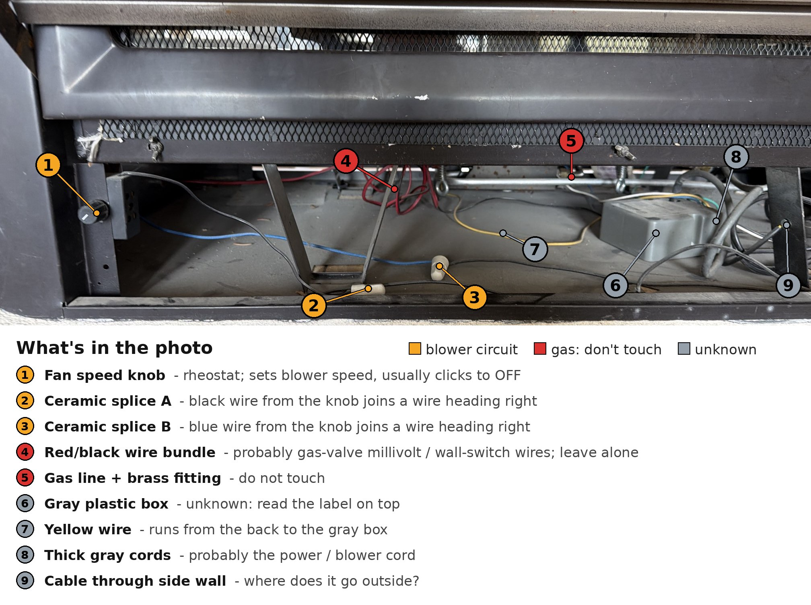

# Fireplace Blower Controller (Raspberry Pi Pico)

Replaces a fireplace's dead fan-temperature switch with a Raspberry Pi Pico.
A heat-proof thermocouple probe watches the firebox. The Pico turns the blower
on when it gets hot and off once it cools down. It also does a few things the
stock switch can't:

- **Adjustable on/off temperatures.** The stock switch is fixed at about 120°F on and 90°F off.
- **Minimum run time**, so the blower doesn't click on and off.
- **Fail-safe.** If the probe breaks or comes unplugged, or the Pico itself dies, the blower **runs** instead of staying off.
- **Optional button** to force the blower on.
- **Status LED**, plus a live temperature log over USB.

> **Cheaper fix first?** If the "temp sensor" that died is the little round
> snap-disc switch near the blower, a replacement (120°F on / 90°F off, about
> $15–25) is a 10-minute swap. This project is for when you want more control
> than that, or just want to build it.

---

## Safety: read this first

- **This only switches the blower.** Don't touch the gas valve, pilot, thermopile, or any of the fireplace's own controls.
- **No mains wiring.** The IoT Relay below is a sealed power strip with a low-voltage control input. You plug things into it like a power strip, and the Pico only ever touches 3.3 volts.
- **Only the probe goes near the heat.** Keep the Pico, the thermocouple board, the relay, and the USB charger somewhere that stays cool enough to touch comfortably. The Pico is rated to 85°C (185°F), and the USB charger less.
- **If your blower is hard-wired (no plug)**, don't splice into 120 V house wiring unless you know how. Have an electrician add an outlet for the blower, then use this setup as-is.
- Fireplaces are designed to run safely without the blower (during power outages, for example). Even so, this design defaults to "blower on" whenever anything goes wrong.

---

## Parts (about $60–80)

| Part | Notes |
|---|---|
| Raspberry Pi Pico (or Pico W / Pico 2) **with headers** | about $5–8 |
| **MAX6675 board + K-type thermocouple** | about $6–10 kit. Get a probe with a **fiberglass or stainless-braided lead** long enough to reach a cool spot (1–2 m). A ring/washer-style or screw-in probe is easiest to mount. A MAX31855 board also works (set `SENSOR = "MAX31855"`). |
| **Digital Loggers "IoT Relay"** (IoT Power Relay II) | about $30–35. Sealed outlet box, switched by a 3.3 V signal. |
| USB phone charger + micro-USB cable | Powers the Pico (USB-C if you have a Pico 2 clone that uses it). |
| Female-to-female jumper wires | 5 for the sensor board, plus 2 longer wires for the relay input. |
| *Optional:* momentary push button | For the "always on" override. |
| *Optional:* small project box | Keeps it tidy. |

---

## How it hooks up

```
                          ┌──────────────── IoT Relay ─────────────────┐
  Wall outlet ───────────▶│  "Always ON"    ◀── USB charger ── Pico    │
                          │  "Normally ON"  ◀── fireplace blower plug  │
                          │  "Normally OFF" ×2  (leave empty)          │
                          │  control input + / −  ◀── Pico GP15 / GND  │
                          └────────────────────────────────────────────┘

  Thermocouple probe (in the heat) ── long lead ──▶ MAX6675 board ──▶ Pico (in the cool)
```

The blower plugs into the **"Normally ON"** outlet, so it runs unless the Pico
actively tells it to stop. That's the fail-safe: if the Pico crashes, loses
power, or a wire falls off, the blower runs. If you use a "Normally OFF" outlet
instead, set `FAN_ON_WHEN_PIN_HIGH = True` in `config.py`.

If your blower has a speed knob (rheostat), leave it in place. The Pico just
switches power to the blower, and the knob still sets the speed.

---

## Wiring

Pin numbers are the **physical pin numbers** printed on the Pico's pinout
(pin 1 is top-left with the USB port at the top).

**MAX6675 board → Pico**

| MAX6675 | Pico pin | Pico name |
|---|---|---|
| VCC | 36 | 3V3(OUT) |
| GND | 23 | GND |
| SCK | 24 | GP18 |
| CS  | 22 | GP17 |
| SO  | 21 | GP16 |

**IoT Relay control input → Pico** (the green screw terminal on the side)

| IoT Relay | Pico pin | Pico name |
|---|---|---|
| **+** | 20 | GP15 |
| **−** | 18 | GND |

**Push button (optional) → Pico**

| Button | Pico pin | Pico name |
|---|---|---|
| one leg | 19 | GP14 |
| other leg | 13 | GND |

**Thermocouple → MAX6675 screw terminals:** on US K-type wire the **red lead is
negative (−)** and the yellow lead is positive (+). If the reading goes *down*
when you heat the probe, swap them.

---

## Load the software

1. **Install MicroPython on the Pico.** Hold the **BOOTSEL** button while
   plugging the Pico into your computer. It shows up as a USB drive. Download
   the matching `.uf2` file from <https://micropython.org/download/> (search
   `RPI_PICO`, `RPI_PICO_W`, or `RPI_PICO2`) and drag it onto that drive. The
   Pico reboots on its own.
2. **Install Thonny** (<https://thonny.org>). In *Tools → Options → Interpreter*,
   pick **MicroPython (Raspberry Pi Pico)**.
3. **Copy the four files onto the Pico.** Open each of `config.py`,
   `fan_control.py`, `thermocouple.py`, and `main.py` in Thonny and use
   *File → Save as… → Raspberry Pi Pico*, keeping the same names. Copy
   `main.py` last.
4. Unplug and replug the Pico. `main.py` runs automatically every time it powers up.

---

## Bench test (before touching the fireplace)

Plug a **lamp** into the relay's "Normally ON" outlet in place of the blower,
and connect the Pico to your computer with Thonny open so you can watch the log:

```
[     10 s]  71.2 F  blower OFF (auto)
[    155 s] 120.2 F  blower ON  (auto)
```

1. **At power-up** the lamp comes on for about 5 seconds (self-test), then turns off because the probe is at room temperature.
2. **Heat the probe** (dip it in a mug of water from the kettle, or use a hair dryer). The lamp turns on once the reading passes 120°F.
3. **Let it cool.** The lamp stays on until the reading drops to 90°F, and always runs for at least 2 minutes once it comes on.
4. **Pull a thermocouple lead out of the screw terminal.** Within about 3 seconds the lamp comes on, the LED flickers fast, and the log says `SENSOR FAULT`.
5. **Press the button** (if wired). The LED blinks slowly and the lamp stays on. Press again to go back to auto.

---

## Map your fireplace's existing wiring




The blower circuit in most fireplace blower kits is simple: **cord → speed knob →
fan temp switch → blower → back to the cord**, with everything in series. The
diagram above is that typical layout matched to the parts in the photo. Confirm
it on your unit before changing anything:

**Do all of this with the fireplace off, cooled down, and its power cord unplugged.**

1. **Find the rating plate.** It's a metal tag, often on a chain in this compartment or riveted to a side wall. The model number leads to the manual, which has the real wiring diagram.
2. **Photograph the label on the gray plastic box** (#6 in the photo) and trace its wires. It might be a junction box, a remote-control receiver, or part of the gas controls.
3. **Follow the two black wires leaving the ceramic splices** (#2 and #3) to their other ends. One should lead to the power cord. The other leads toward the temp switch or the blower.
4. **Find the fan temp switch.** It's a disc about 1" across with two spade terminals, usually on the underside of the firebox or on the blower housing, often stamped with something like `F120-20F` or `L120`.
5. **Test the switch with a multimeter on continuity**, with one wire pulled off it:
   - Cold: **no beep (open)**. *That's normal.* The switch is supposed to be open when cold.
   - After heating it with a hair dryer for a minute: it **should beep**. If it never closes when hot, it's dead.
6. **Test the knob:** continuity across its two wires (black and blue). It should be open in the OFF click and beep when turned up.
7. **Quick proof, no Pico needed:** still unplugged, join the temp switch's two wires together with a short insulated jumper. Plug in and turn the knob. If the blower runs, the temp switch was the problem and the rest of the circuit is fine. That jumper is exactly what the Pico setup uses.

The red wires (#4) and the gas line (#5) belong to the gas valve, a separate
system. Don't connect anything to them.

## Install in the fireplace

1. **Unplug the fireplace blower** and, for gas, turn the fireplace off and let it cool completely.
2. **Mount the probe where the old sensor was.** That spot is usually a snap disc screwed or magnet-mounted to the underside of the firebox, or on the blower housing. Bolt a ring/washer probe under the old sensor's screw, or clamp the probe tip firmly against the bare metal. Good metal contact matters more than anything else.
3. **Route the probe lead** out of the hot area to where the electronics will sit. Keep it away from moving fan blades and sharp edges.
4. Place the Pico, the MAX6675 board, and the IoT Relay somewhere **cool**, such as beside the fireplace or behind the lower grill if it stays comfortable to touch.
5. Plug the blower into **"Normally ON"** and the USB charger into **"Always ON"**.

## Tune it

The 120°F / 90°F defaults copy the stock switch, but your probe spot may run
hotter or cooler than the original. Watch the log in Thonny during a real fire
(or just watch when the blower kicks on), then edit `config.py`:

- **Blower comes on too late** (the room is already warm before it starts): lower `FAN_ON_F`.
- **Blower blows cool air at the start** or keeps cycling: raise `FAN_ON_F`.
- **Blower stops while the glass is still hot:** lower `FAN_OFF_F`.
- **Blower runs long after the fire is out:** raise `FAN_OFF_F`.

Keep `FAN_OFF_F` at least 15–20°F below `FAN_ON_F`.

**To edit files later:** because the watchdog auto-reboots the Pico, press
**Stop** in Thonny within 5 seconds of plugging the Pico in, while the LED is
flickering at startup. If Thonny keeps disconnecting, keep pressing Stop until
it catches that window. Or set `WATCHDOG = False` while you experiment.

---

## What the LED means

| LED | Meaning |
|---|---|
| Fast flicker for the first 5 s | Starting up (blower runs during this) |
| Short blip every 3 s | Idle, everything OK, blower off |
| Solid on | Blower running (auto) |
| Slow blink (1 per second) | Button set the blower to **always on** |
| Fast flicker (after startup) | **Sensor fault.** Check the probe and its wiring. The blower is forced on. |

---

## Troubleshooting

| Problem | Try |
|---|---|
| Log shows `SENSOR FAULT` right away | Check the five MAX6675 wires (SO→GP16, CS→GP17, SCK→GP18), check that VCC goes to **3V3(OUT)** (pin 36), not VBUS, and tighten the thermocouple screws. |
| Temperature goes down when heated | Swap the thermocouple's red and yellow leads. |
| Reading is stuck or jumpy | Make sure the probe tip, not just the lead, is touching the metal. Keep the MAX6675 board itself out of the heat. |
| MAX31855 shows a fault only while plugged into a PC | The probe tip is touching grounded metal and the PC's USB ground completes the circuit. Use an "ungrounded" probe, use a MAX6675, or run it off the USB charger. |
| Blower runs when cold and stops when hot | The outlet and `FAN_ON_WHEN_PIN_HIGH` don't agree: "Normally ON" outlet needs `False`, "Normally OFF" needs `True`. |
| Blower never turns off | The relay's control input is wired backwards. Swap the wires on its **+/−** terminals (+ goes to GP15). |
| Blower never turns on | Check the log temperature against `FAN_ON_F`, and check that the blower's own speed knob isn't at off. |

---

## Files

| File | What it is |
|---|---|
| `config.py` | All the settings: temperatures, pins, sensor type |
| `main.py` | Runs at power-up: reads the sensor, drives the relay, LED, and button |
| `fan_control.py` | The on/off decision logic (hysteresis, minimum run time, fault handling) |
| `thermocouple.py` | Drivers for MAX6675 / MAX31855 boards |
| `tests/` | PC tests, including a simulated fire run against fake Pico hardware: `python3 -m unittest discover -s tests` |
